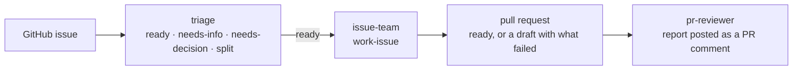

# number-5

*Need input.*

[](https://github.com/Viaanix/number-5/actions/workflows/check.yml)

**Hand an issue to a team of AI agents. Get back a reviewed pull request, or a draft that says exactly what failed.**

number-5 is a set of agent teams built on [docker-agent](https://github.com/docker/docker-agent), and `j5`, the one command that runs any of them against any repository. Work happens in a worktree beside your project, on the model you pick, and you can see the exact command before anything runs.

```bash
cd ~/code/some-repo
j5 triage triage --issue 123              # is this issue ready to work on? label it, or split it
j5 issue-team work-issue --issue 123      # issue → pull request (a draft if review or tests don't pass)
j5 pr-reviewer review --queue-unreviewed  # review every open PR that changed since its last review
```

## What you get

- **Predictable about your checkout.** issue-team builds in a separate worktree next to your project, reviews run on a read-only snapshot, and triage only reads. (test-quality edits the checkout you are in, on purpose.) `--print` shows the exact command first, and triage has a dry-run switch that writes nothing.
- **A reviewer that is not grading its own homework.** In a team with builders and a reviewer, j5 puts the reviewer on a different model tier than the builders, and refuses to launch if it cannot.
- **Limits live in code, not in prompts.** The triage agent can apply four labels, post one comment and create up to eight sub-issues, because its helper refuses anything else. A review is posted only if it names the commit it reviewed and passes a credential scan. The issue or PR text an agent reads is written by other people, so the rules are not left to the model.
- **Unattended when you want it.** `--queue 120,123`, `--queue-label bug` or `--queue-unreviewed` runs a team over a list, one item at a time. Each item ends in a `RESULT:` line that j5 reads, and you get a log per item and a summary.
- **Claims need receipts.** Every agent runs with the `j5-craft` rule: cite `file:line` copied from tool output, re-open it before reporting, and say what was not run.
- **Your choice of model, per run.** `--model haiku|sonnet|opus|fable` and `--effort low|medium|high|xhigh`, on every team.
- **Linux, macOS and Windows.** CI runs on all three.

## See it work

A real run: `j5 pr-reviewer review --queue-unreviewed` on a scratch repository with three open PRs: one with a planted bug, one docs-only, and a draft, which it left alone (log paths trimmed).

```text
2 of 2 finished (0 opened a pull request, 2 completed without one).

- #1: DONE: Needs work PR #1: pageCount uses Math.floor instead of a ceiling, so it undercounts and lastPage returns the wrong page or an empty list. (log: …)
- #2: DONE: Ship it PR #2: README-only line stating Node 20+; no findings, and the final context gate matched the initial snapshot. (log: …)
```

Each review was posted as a comment on its pull request, under the stamp `Reviewed head SHA: <commit>`. Push a commit and the next run reviews that PR again; run it twice with nothing new and it says so and exits 0.

It also reviewed the pull request that added this very queue ([#42](https://github.com/Viaanix/number-5/pull/42)) and found a bug the author's tests had missed: one fork PR would have stopped the whole queue before anything ran. It was fixed before the merge.

## How the pieces fit



Each box is its own command. You decide what runs next, and `--queue` runs one stage over a list. There is no automatic hand-off between them.

## The teams

| Team | Run | What it does |
|---|---|---|
| [triage](workflows/triage/README.md) | `j5 triage triage --issue 123` | Reads an issue and the code it concerns, read-only, and decides whether it can be worked on as written: label it ready, needs-info or needs-decision, or split it into sub-issues |
| [issue-team](workflows/issue-team/README.md) | `j5 issue-team work-issue --issue 123` | GitHub issue → pull request, in any repository: ready when review and verification pass, a draft when they do not |
| [pr-reviewer](workflows/pr-reviewer/README.md) | `j5 pr-reviewer review --pr 456` | A static review of a pull request: returns a report and posts it as one PR comment. `--queue-unreviewed` reviews every open PR that has changed since its last review |
| [test-quality](workflows/test-quality/README.md) | `j5 test-quality audit --target tests/` | Audit, review, write or fix tests with the `j5-test-quality` skill, in the current checkout |

Writing your own is a directory with a `team.yaml` and a `workflow.yaml`: see [docs/new-team.md](docs/new-team.md).

## Quick start

**New to this, or on Windows or macOS?** Follow the step-by-step [Getting started guide](docs/getting-started.md): every tool, token and command, for Linux, macOS and Windows.

Prerequisites: Docker with the `docker agent` plugin (v1.145.0), [Bun](https://bun.sh), `git` and `gh`. Every team uses the logged-in [proxy container](containers/pi-openai-proxy/README.md) and its local `PI_PROXY_AUTH_TOKEN`, not an Anthropic API key. `j5 setup` checks all of this.

**Install the package** (teammates; needs a one-time registry token, see [docs/packaging.md](docs/packaging.md#install-teammates)):

```bash
bun add -g @viaanix/number-5
j5 setup                    # checks your tools, installs the skills
j5 setup --proxy --login    # optional: start the local proxy and log it in
j5 list
cd ~/code/some-repo && j5 issue-team work-issue --issue 123
```

**From a clone** (changing number-5 itself):

```bash
bun scripts/install.ts      # link ~/number-5, add `j5` to your shell, install skills, bun install
# open a new terminal (bash, zsh, or PowerShell on Windows), then:
j5 list
cd ~/code/some-repo && j5 issue-team work-issue --issue 123
j5                         # or pick everything interactively
```

## Where it stands

Version 0.1.x. What has actually been run, so you know how much to trust each team:

| Team | Run for real | Not yet |
|---|---|---|
| pr-reviewer | Reviews of real PRs, including this repository's own, and the unreviewed queue on a scratch repository (three PRs) | A pull request from a fork; the queue on a busy repository |
| triage | Three issues (one dry run, two written), with the labels and comments checked on GitHub; the sub-issue call, made directly | The agent choosing `split` or `ready` on its own |
| issue-team | Dry runs against the installed docker-agent, and the unit tests | A real end-to-end run on the current proxy image |
| test-quality | `audit` | `review-branch`, `write-tests` and `fix-failing` |

Start with `--print`, and with `J5_TRIAGE_DRY_RUN=1` for triage. Comments post as whichever `gh` account is logged in, so they read as written by you. Every release lists what it did not verify under "Not verified" on its [release page](https://github.com/Viaanix/number-5/releases).

## Docs

- [docs/launcher.md](docs/launcher.md) — `j5` options and the `workflow.yaml` manifest
- [docs/packaging.md](docs/packaging.md) — installing number-5 as a package, `j5 setup`, releasing
- [docs/new-team.md](docs/new-team.md) — adding a team or experiment
- [docs/docker-agent/](docs/README.md) — reference, patterns and gotchas
- [containers/pi-openai-proxy/](containers/pi-openai-proxy/README.md) — pinned subscription-backed model endpoint for native Docker Agent agents

## Development

`bun run check` runs typecheck, lint and format checks (Oxlint and Oxfmt through [Vite+](https://viteplus.dev), configured in `vite.config.ts`), shellcheck, the bun tests and team validation. CI runs all of it on Linux; macOS runs everything except team validation; Windows runs typecheck, lint, format and the bun tests (`.github/workflows/check.yml`). Each commit also runs `vp check --fix` on the staged files through a pre-commit hook. Details in [CLAUDE.md](CLAUDE.md).
