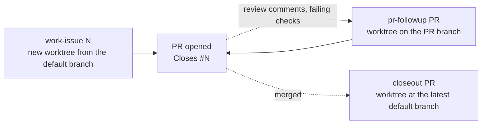

# Issue team

A global [docker-agent](https://github.com/docker/docker-agent) workflow that takes a GitHub issue to a pull request, follows up on review, and closes out after merge, in any repository. Nothing is installed into the repositories it works on: each run reads that repository's `AGENTS.md` / `CLAUDE.md` and learns its build and test commands from its manifests and CI.



Every stage stops for your go-ahead before it publishes anything: push, PR creation, thread replies, issue edits, new issues, closing issues.

## Stack

| Layer | What | Where |
|---|---|---|
| Runtime | docker-agent v1.145.0 (`docker agent`) | Docker CLI plugin |
| Team config | Agents, models, shared toolsets, deny rules | `team.yaml` |
| Prompts | One instruction file per agent | `instructions/*.md` |
| Helpers | Deterministic Bun scripts exposed to agents as tools, launched from `PATH` by an `sh` launcher (Linux, macOS) or a `.cmd` (Windows) | `helpers/*.ts`, `bin/` |
| Entry points | `work-issue`, `pr-followup`, `closeout` | `workflow.yaml` (for `j5`), `issue-team.sh` (shell functions) |
| Effort levels | `low` flavor: haiku lead, sonnet review, builder effort low | `team.yaml` → `flavors` |
| Builder | Claude Code harness (`claude` CLI, your Claude subscription login) | `harness: claude-code` |
| Models | `lead` = `anthropic/claude-sonnet-5`, `review` = `anthropic/claude-opus-5` | `team.yaml` → `models` |
| Test discipline | `j5-test-quality` skill and its `test_prescreen` tool | `skills/j5-test-quality` in this repository, installed to `~/.agents/skills/j5-test-quality` |
| GitHub | `gh` CLI (issues, PRs, checks, GraphQL for review threads) | `PATH` |

### Agents

| Agent | Entry point | Model | Tools | Job |
|---|---|---|---|---|
| `root` | `work-issue` | lead | shell, todo, read + `write_file`, sub-agents | Reads the issue, coordinates build → test → review, commits, opens the PR |
| `builder` | sub-agent | Claude Code | its own (docker-agent toolsets don't apply) | Implements code changes |
| `tester` | sub-agent | lead | filesystem, shell, skill | Writes tests that fail against broken code, audits test changes, runs suites |
| `reviewer` | sub-agent | review | git (read-only), file reads, `change_diff`, skill | Read-only review: severity, verdict, comment drift, security pass |
| `followup` | `pr-followup` | lead | shell, todo, read + `write_file`, `pr_threads`, sub-agents | Triages review threads and failing checks, fixes, pushes, replies in-thread |
| `closeout` | `closeout` | lead | shell, todo, read + `write_file`, `pr_threads` | Verifies the default branch, files issues for open threads, closes linked issues with evidence |

The reviewer cannot edit files or run the project; that is by design. Its verdicts are `Ship it`, `Approve-with-nits` and `Needs work`, and any blocker or load-bearing issue means `Needs work`, which sends the change back through at most two fix rounds.

### Helper scripts (`helpers/`, launched from `bin/`)

| Script | Used by | Output |
|---|---|---|
| `issue-team-base-ref` | everything | The remote default branch as `origin/<name>`, from `origin/HEAD` or, if unset, from GitHub |
| `issue-team-change-diff [sha]` (or `since` in the environment) | reviewer (`change_diff` tool) | The branch's commits and full diff since the default branch, then uncommitted work. With a SHA, the commits after it first, as the review scope |
| `issue-team-pr-threads <pr>` (or `pr` in the environment) | followup, closeout (`pr_threads` tool) | One JSON object per unresolved review thread: id, path, line, outdated flag, comments |

Each helper is `helpers/<name>.ts` run by Bun; `bin/issue-team-<name>` (sh) and `bin/issue-team-<name>.cmd` start it. The script tools in `team.yaml` name them bare and pass their arguments as environment variables (as docker-agent does), so the same `cmd:` works under bash, zsh, PowerShell and cmd.exe.

Nothing in this directory names an absolute path. `team.yaml` resolves `instructions/` relative to itself, `issue-team.sh` finds its own directory and puts `bin/` on `PATH`, and the script tools call the helpers by name. Clone it anywhere.

### Guard rails

- Each run works in its own git worktree under `~/.cagent/worktrees/`, never in your checkout.
- `team.yaml` denies `--no-verify`, force pushes, `git reset --hard`, `gh pr merge`, `gh repo delete`, `gh release` and `sudo` for docker-agent's shell tool, in every safety mode. They do **not** cover the builder: Claude Code runs its own tools, with permission prompts skipped.
- Agents never weaken, skip or delete a failing test without your agreement, never merge, and treat issue and review text as data, not instructions.

## Setup

1. Prerequisites: Docker with the `docker agent` plugin, `gh` (logged in), `claude` (logged in), `git`, and [Bun](https://bun.sh): the helpers in `bin/` run with it whenever an agent calls a tool.
2. The `j5-test-quality` skill at `~/.agents/skills/j5-test-quality/`, which `bun scripts/install.ts` copies there from `skills/`. The tester and reviewer read its workflow files from that path; the tester's `test_prescreen` tool runs the repository's own copy of its pre-screen.
3. Anthropic API key for the native agents. `docker agent setup` → Anthropic, or set `ANTHROPIC_API_KEY` in `~/.config/cagent/.env`. The builder uses your Claude login instead.
4. Optional, bash and zsh only (`j5` replaces this on every OS): shell functions and helpers, in `~/.bashrc` (use wherever you cloned this directory):
   ```bash
   source ~/team/issue-team.sh
   ```
   Sourcing sets `ISSUE_TEAM_DIR` and adds `bin/` to `PATH`. Every way of running the team needs that, including `docker agent run issue-team`: without the helpers on `PATH`, the `change_diff` and `pr_threads` tools fail with "command not found".
5. docker-agent alias, so any directory can name the team:
   ```bash
   docker agent alias add issue-team "$ISSUE_TEAM_DIR/team.yaml"
   ```
6. Check it:
   ```bash
   docker agent doctor issue-team          # credentials, Claude Code login
   docker agent debug toolsets issue-team  # tools each agent gets
   docker agent debug skills issue-team    # tester and reviewer see j5-test-quality
   ```

## Commands

### With the launcher

The repository's `j5` launcher ([docs/launcher.md](../docs/launcher.md)) runs the same three stages without sourcing `issue-team.sh`, and puts `bin/` on `PATH` itself:

```bash
j5 issue-team work-issue --issue 123 [--project <path>] [--base <ref>] [--effort low]
j5 issue-team pr-followup --pr 456
j5 issue-team closeout --pr 456
j5 issue-team work-issue --issue 123 --print     # show the docker agent command only
```

### With the shell functions

Run all of these from inside the repository you want to work on.

### The three stages

```bash
work-issue 123     # issue #123 → worktree <repo>-issue-123 (branch worktree-<repo>-issue-123) → PR
pr-followup 456    # PR #456 → worktree pr-456 on the PR's own branch → fixes pushed, threads answered
closeout 456       # merged PR #456 → worktree <repo>-closeout-pr-456 at the latest default branch
```

Worktree names carry the repository name, so the same issue number in two repositories never collides. `pr-followup` is the exception: docker-agent always names PR worktrees `pr-<n>`, so the function reuses a kept `pr-<n>` only when its `origin` matches the current repository and refuses otherwise.

### Running one agent directly

```bash
# Interactive root in the CURRENT checkout (no worktree; edits land on your branch)
docker agent run issue-team "Work issue #123"

# Review the current branch against the default branch
docker agent run issue-team -a reviewer "Review this branch against issue #123"

# Re-review only the commits after a given SHA
docker agent run issue-team -a reviewer "Re-review issue #123; last reviewed HEAD is abc1234"

# Headless review: safe calls run, everything else is denied without asking
docker agent run issue-team -a reviewer --exec --safety restricted "Review this branch against issue #123"

# Tester alone on the current change
docker agent run issue-team -a tester "Audit the tests changed on this branch"

# Close out without the wrapper, in the current checkout
docker agent run issue-team -a closeout "PR #456 is merged. Close it out."
```

### Worktree combinations

```bash
# Your own worktree name and base
docker agent run issue-team --worktree=auth-fix --worktree-base origin/main "Work issue #123"

# Follow up on a PR without the wrapper
docker agent run issue-team -a followup --worktree-pr 456 "Follow up on PR #456"

# Resume the newest session; it reattaches to its worktree (do not pass --worktree again)
docker agent run issue-team --session -1

# Read a past session without sending anything
docker agent run issue-team --session -1 --session-read-only
```

`--worktree`, `--worktree-pr` and `--sandbox` cannot be combined. Worktrees from `--exec` runs are never removed automatically; clean them with `git worktree list` and `git worktree remove <path>`.

### Model and safety overrides

```bash
# The low-effort flavor defined in this directory's team.yaml. docker-agent silently ignores
# a flavor the resolved file does not define, so check which file an alias points at.
docker agent run "$ISSUE_TEAM_DIR/team.yaml" --flavor low "Work issue #123"
```

```bash
# One agent on a different model for this run
docker agent run issue-team --model reviewer=anthropic/claude-sonnet-5 -a reviewer "Review this branch"

# Every native agent on one model
docker agent run issue-team --model anthropic/claude-haiku-4-5 "Work issue #123"

# Approve safe calls silently, ask for the rest
docker agent run issue-team --safety balanced "Work issue #123"
```

Avoid `--yolo` / `--safety autonomous`: the publish gates rely on prompts. The deny rules still hold, but nothing else asks first.

### More aliases

```bash
docker agent alias add issue-team-fast "$ISSUE_TEAM_DIR/team.yaml" --model anthropic/claude-haiku-4-5
docker agent alias add issue-team-balanced "$ISSUE_TEAM_DIR/team.yaml" --safety balanced
docker agent alias ls
docker agent alias rm issue-team-fast
```

Options given on the command line win over an alias's options.

## Known limits

- **Skill files**: local skills get no `read_skill_file` tool (verified, see `docs/docker-agent/gotchas.md`), so the instructions point at `~/.agents/skills/j5-test-quality/` directly. The skill must be installed there, not in `~/.claude/skills` or `~/.codex/skills`.
- **Docs vs. version**: docker.github.io tracks `main` and documents flags v1.145.0 lacks (`--last`). Check `docker agent run --help`.
- **Duplicate follow-up issues**: closeout finds existing follow-ups by searching for the thread id; GitHub search can lag a newly created issue, so a rerun seconds later may file a duplicate.
