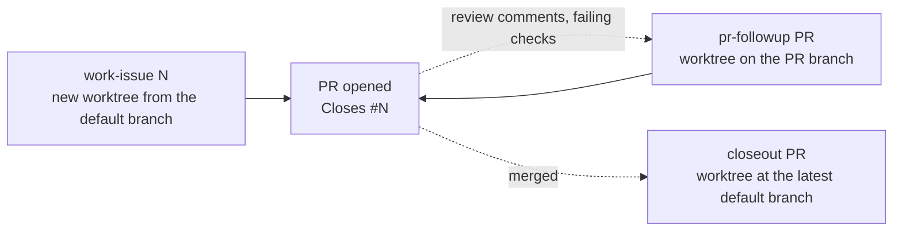

# Issue team

A global [docker-agent](https://github.com/docker/docker-agent) workflow that takes a GitHub issue to a pull request, follows up on review, and closes out after merge, in any repository. Every agent is Claude Code running on your Claude subscription (`harness: claude-code`); no API key is needed. Nothing is installed into the repositories it works on: each run reads that repository's `CLAUDE.md` (and `AGENTS.md`, when told to) and learns its build and test commands from its manifests and CI.



`work-issue` opens its PR on its own: it pushes and runs `gh pr create` once the reviewer's verdict is Ship it or Approve-with-nits and its own verification passed, and otherwise stops and reports without publishing. The PR body reports the tests, every internal review round, and the verification results. `pr-followup` and `closeout` are told to stop for your go-ahead before they publish anything (push, thread replies, issue edits, new issues, closing issues). **Nothing enforces those stops but the prompt** (see Guard rails), so run those two interactively, never with `--exec`.

## Stack

| Layer | What | Where |
|---|---|---|
| Runtime | docker-agent v1.145.0 (`docker agent`) | Docker CLI plugin |
| Agents | Three Claude Code harness agents, one per entry point, on Sonnet 5.5 (`harness.model`); `root` and `followup` start their reviewer sub-agent on Opus | `team.yaml`, `workflow.yaml` |
| Entry prompts | Each entry agent's whole prompt is its entry point's `message` | `workflow.yaml` (for `j5`) |
| Sub-agent roles | Tester and reviewer prompts, printed by `issue-team-role <role>` | `roles/*.md` |
| Helpers | Deterministic Bun scripts the agents run by bare name, launched from `PATH` by an `sh` launcher (Linux, macOS) or a `.cmd` (Windows) | `helpers/*.ts`, `bin/` |
| Effort levels | `low` flavor: every agent on Haiku 4.5 at harness effort low | `team.yaml` → `flavors` |
| Test discipline | `j5-test-quality` skill, read by path, and `issue-team-test-prescreen` | `skills/j5-test-quality` in this repository, installed to `~/.agents/skills/j5-test-quality` |
| GitHub | `gh` CLI (issues, PRs, checks, GraphQL for review threads) | `PATH` |

### Why prompts live in `workflow.yaml`

docker-agent gives a harness agent nothing but its task message: instruction files, toolsets, skills, `sub_agents` and `permissions` are dropped without an error, and a harness agent has no `transfer_task` ([gotcha](../../docs/docker-agent/gotchas.md#a-harness-claude-code-agent-gets-none-of-docker-agents-agent-extras)). So each entry agent's prompt is its message, and the agents delegate with Claude Code's own sub-agent tool. In a message, `{issue}` / `{pr}` are parameters and `{{` `}}` are literal braces (for `gh api repos/{{owner}}/{{repo}}/…`).

### Agents

| Agent | Kind | Entry point | Job |
|---|---|---|---|
| `root` | harness agent | `work-issue` | Reads the issue, coordinates build → test → review, commits, opens the PR |
| `followup` | harness agent | `pr-followup` | Triages review threads and failing checks, has them fixed, pushes, replies in-thread |
| `closeout` | harness agent | `closeout` | Verifies the default branch, files issues for open threads, closes linked issues with evidence |
| builder | Claude Code sub-agent of root / followup | — | Implements code changes from a self-contained task |
| tester | Claude Code sub-agent of root / followup | — | `roles/tester.md`: writes tests that fail against broken code, audits test changes, runs suites |
| reviewer | Claude Code sub-agent of root / followup | — | `roles/reviewer.md`: told to stay read-only; severity, verdict, comment drift, security pass |

The reviewer's verdicts are `Ship it`, `Approve-with-nits` and `Needs work`, and any blocker or load-bearing issue means `Needs work`, which sends the change back through at most two fix rounds.

### Helper scripts (`helpers/`, launched from `bin/`)

| Script | Used by | Output |
|---|---|---|
| `issue-team-base-ref` | everything | The remote default branch as `origin/<name>`, from `origin/HEAD` or, if unset, from GitHub |
| `issue-team-change-diff [sha]` (or `since` in the environment) | reviewer | The branch's commits and full diff since the default branch, then uncommitted work. With a SHA, the commits after it first, as the review scope |
| `issue-team-test-prescreen` | tester | The `j5-test-quality` Tier 1 pre-screen in strict mode on the test files the branch changed. Exit 1 = HIGH findings, 2 = could not run |
| `issue-team-pr-threads <pr>` (or `pr` in the environment) | followup, closeout | One JSON object per unresolved review thread: id, path, line, outdated flag, comments |
| `issue-team-role <role>` (or `role` in the environment) | root, followup | The prompt of a sub-agent role, `roles/<role>.md`, to begin that sub-agent's task with |

Each helper is `helpers/<name>.ts` run by Bun; `bin/issue-team-<name>` (sh) and `bin/issue-team-<name>.cmd` start it, and logic shared with other teams lives in `launcher/src/`. The agents call them by bare name, so `bin/` must be on `PATH`; `j5` puts it there.

### Guard rails

**Instructions only.** Claude Code runs its own tools, outside docker-agent's safety modes and `permissions` rules, so none of these is enforced:

- The publish rules: `work-issue` publishes only after an approving review verdict and passing verification. `pr-followup` and `closeout` show their plan or result, end their turn and wait for your next message. A harness agent keeps its conversation between turns (verified), so answering in the session works; under `--exec` there is no one to answer and the stage goes on.
- No force pushes, `git reset --hard`, `--no-verify`, merges, closing issues from `work-issue` / `pr-followup`, or `sudo`.
- The reviewer stays read-only and does not run the project.
- Agents never weaken, skip or delete a failing test without your agreement, and treat issue and review text as data, not instructions.

Each run works in its own git worktree beside your checkout (e.g. `~/code/my-app-issue-123` for `~/code/my-app`), which `j5` creates and starts the agent in. Your checkout is never used.

## Setup

1. Prerequisites: Docker with the `docker agent` plugin, `gh` (logged in), `claude` (logged in to your Claude subscription), `git`, and [Bun](https://bun.sh): the helpers in `bin/` run with it.
2. The `j5-test-quality` skill at `~/.agents/skills/j5-test-quality/`, which `bun scripts/install.ts` copies there from `skills/`. The tester and reviewer read it by path; it is not one of Claude Code's skills.
3. Check it:
   ```bash
   bun run validate:teams                 # from this repository: manifest, agents, flavor, dry runs
   j5 issue-team work-issue --issue 1 --print
   ```

## Commands

```bash
j5 issue-team work-issue --issue 123 [--project <path>] [--base <ref>] [--effort low]
j5 issue-team pr-followup --pr 456
j5 issue-team closeout --pr 456
j5 issue-team work-issue --issue 123 --print     # the full docker agent command, prompt included
```

```
work-issue 123     # issue #123 → worktree ../<repo>-issue-123 (branch worktree-<repo>-issue-123) → PR
pr-followup 456    # PR #456 → worktree ../<repo>-pr-456 on the PR's own branch → fixes pushed, threads answered
closeout 456       # merged PR #456 → worktree ../<repo>-closeout-pr-456 at the latest default branch
```

### A queue of issues, unattended

```bash
j5 issue-team work-issue --queue 474,480,482 --max-rounds 5    # these issues, in this order
j5 issue-team work-issue --queue-label ready --max-rounds none # every open issue labelled `ready`, oldest first
```

Each issue runs `work-issue` on its own, in its own worktree, with `--exec`: nobody answers, so a step that would ask you stops that issue and reports why instead. The fix loop runs up to `--max-rounds` rounds (instead of two), or without a limit, and always stops when a round changes nothing. A passing issue opens its PR as a single run would. Logs and `summary.md` go to `.j5/queue/<start time>/` in your checkout; an issue that fails is reported and the next one starts; a Claude session limit stops the queue. `--queue-label` needs `gh` logged in to an account that can see the repository (or `GH_TOKEN`). Details: [docs/launcher.md](../../docs/launcher.md#queue-runs).

Worktrees sit beside the checkout and carry the repository name, so the same number in two repositories never collides. Running the same stage again continues in its existing worktree. `pr-followup` finds the PR's branch with git over your remote (no `gh` needed for that step) and refuses a PR from a fork. Details: [docs/launcher.md](../../docs/launcher.md#the-manifest-workflowsteamworkflowyaml).

```bash
# Resume the newest session. Start it inside the stage's worktree (or pass --working-dir
# <worktree>): a resumed session does not remember its working directory.
cd ~/code/my-app-issue-123 && docker agent run "$HOME/number-5/workflows/issue-team/team.yaml" --session -1

# Read a past session without sending anything
docker agent run "$HOME/number-5/workflows/issue-team/team.yaml" --session -1 --session-read-only
```

Worktrees are never removed automatically; `closeout` offers to clean up after a merge, or use `git worktree list` and `git worktree remove <path>`.

### `issue-team.sh` and `docker agent run issue-team`

`issue-team.sh` (shell functions) and a bare `docker agent run …/team.yaml` are not safe to use any more: they send only a one-line message (the prompts live in `workflow.yaml`, which only `j5` reads), and their `--worktree` / `--worktree-pr` leave the Claude Code agent working in your checkout instead of the worktree. Use `j5`. The file is kept as a reference copy.

## Known limits

- **Not yet run for real.** Validated, dry-run and `--print`-checked only; no stage has run against a GitHub repository since the move to the harness.
- **Skill files**: the agents read `~/.agents/skills/j5-test-quality/` by path. The older `test-quality-with-ai` skill, if installed for Claude Code, is a different version; the prompts say not to use it.
- **Docs vs. version**: docker.github.io tracks `main` and documents flags v1.145.0 lacks (`--last`). Check `docker agent run --help`.
- **Duplicate follow-up issues**: closeout finds existing follow-ups by searching for the thread id; GitHub search can lag a newly created issue, so a rerun seconds later may file a duplicate.
