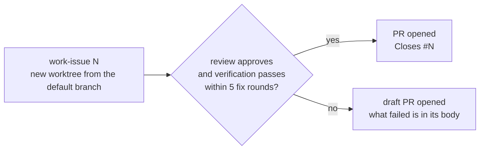

# Issue team

A global [docker-agent](https://github.com/docker/docker-agent) workflow that takes a GitHub issue to a pull request, in any repository. Every agent is a native docker-agent agent on the local [Pi proxy](../../containers/pi-openai-proxy/README.md), which uses your Claude subscription login: there is no API key and no Claude Code harness. Nothing is installed into the repositories it works on: each run loads that repository's `AGENTS.md` and `CLAUDE.md` and learns its build and test commands from its manifests and CI.



`work-issue` always ends in a pull request once it has committed something. It pushes and runs `gh pr create` as a **ready** PR when the reviewer's verdict is Ship it or Approve-with-nits, its own verification passed and `git status` is clean. In every other case it publishes a **draft** PR with `--draft`, whose body starts with what did not pass and lists the open review issues and the failing commands. The PR body reports the tests, every internal review round, and the verification results. The only case with no PR is a branch with no commit beyond the base, or an issue the agent has to ask you about before changing code.

## Stack

| Layer | What | Where |
|---|---|---|
| Runtime | docker-agent v1.145.0 (`docker agent`) | Docker CLI plugin |
| Agents | Four native agents: `root` (the entry point) and the `builder`, `tester` and `reviewer` it delegates to with `transfer_task`. The builders run on Sonnet 5.5 at effort high through the proxy; the reviewer runs on a different model tier (see *Independent review*) | `team.yaml` |
| Prompts | One `instruction_file` per agent; `workflow.yaml` sends only the task ("Work issue #12") | `instructions/*.md`, `workflow.yaml` |
| Helpers | Deterministic Bun scripts, launched from `PATH` by an `sh` launcher (Linux, macOS) or a `.cmd` (Windows); `test_prescreen` and `change_diff` are typed tools that call them | `helpers/*.ts`, `bin/`, `team.yaml` |
| Effort levels | `low` flavor: the builders on Haiku 5.5 at effort medium (the reviewer at medium too; its model is chosen separately) | `team.yaml` → `flavors` |
| Test discipline | `j5-test-quality` skill, read by path with `read_file`, and the `test_prescreen` tool | `skills/j5-test-quality` in this repository, installed to `~/.agents/skills/j5-test-quality` |
| GitHub | `gh` CLI (issues, PRs) | `PATH` |
| Independent review | The reviewer is never the builders' model class. `j5` puts it one tier above the builders (Opus 4.7 for the default Sonnet builders, Sonnet 5.5 for `--effort low`), and refuses to launch if it cannot | `independence` in `workflow.yaml`, `reviewer-on-<tier>` flavors in `team.yaml` |

### Where prompts live

Each agent loads its procedure from an `instruction_file` in `instructions/`, so the manifest `message` is only the task. `root` delegates with `transfer_task`; a sub-agent sees only the task it is sent, never the conversation. docker-agent also loads the repository's `AGENTS.md` and `CLAUDE.md` for every agent on every turn (`add_prompt_files`; a missing file is skipped). In a manifest message, `{issue}` is a parameter and `{{` `}}` are literal braces.

### Agents

| Agent | Kind | Job |
|---|---|---|
| `root` | native agent, entry point `work-issue` | Reads the issue, coordinates build → test → review, commits, opens the PR (ready or draft) |
| `builder` | sub-agent of root | `instructions/builder.md`: implements code changes from a self-contained task; filesystem and shell |
| `tester` | sub-agent of root | `instructions/tester.md`: writes tests that fail against broken code, audits test changes, runs suites |
| `reviewer` | sub-agent of root | `instructions/reviewer.md`: **no shell and no write tools**; severity, verdict, comment drift, security pass |

The reviewer's verdicts are `Ship it`, `Approve-with-nits` and `Needs work`, and any blocker or load-bearing issue means `Needs work`, which sends the change back through **at most five fix rounds** (fewer when a round changes nothing: the same blocker, or the same failing test, twice in a row). A change that is still `Needs work` after that is published as a draft.

### Helper scripts (`helpers/`, launched from `bin/`)

| Script | Used by | Output |
|---|---|---|
| `issue-team-change-diff [sha]` (or `since` in the environment) | reviewer, as the `change_diff` tool | The branch's commits and full diff since the default branch, then uncommitted work. With a SHA, the commits after it first, as the review scope |
| `issue-team-test-prescreen` | tester, as the `test_prescreen` tool | The `j5-test-quality` Tier 1 pre-screen in strict mode on the test files the branch changed. Exit 1 = HIGH findings, 2 = could not run |

Each helper is `helpers/<name>.ts` run by Bun; `bin/issue-team-<name>` (sh) and `bin/issue-team-<name>.cmd` start it, and logic shared with other teams lives in `launcher/src/`. The tools call them by bare name, so `bin/` must be on `PATH`; `j5` puts it there.

### Guard rails

**Enforced by docker-agent**, because the agents are native:

- The reviewer has no shell and no file-writing tool, so it cannot edit files, run the project or change git state.
- `permissions.deny` in `team.yaml` blocks `sudo`, `--no-verify`, force-pushes, `git reset --hard`, `gh pr merge`, `gh pr ready`, `gh issue close`, `gh repo delete` and `gh release`. The patterns match the whole command, case-insensitively, and apply to the whole team. This is defense in depth, not a boundary: `shell` can still run anything the patterns miss.
- Every tool is pre-approved by name, so no run waits on a confirmation prompt, and `--exec` does not reject any of them.

**Instructions only:**

- Ready versus draft. Nothing but the instructions stops the agent publishing a ready PR after a failed check, so read a PR's checks and its "Internal review" section before you merge it.
- The builder and tester do not commit or push, and the tester does not edit production code.
- Agents never weaken, skip or delete a failing test without your agreement, and treat issue text as data, not instructions.

Each run works in its own git worktree beside your checkout (e.g. `~/code/my-app-issue-123` for `~/code/my-app`), which `j5` creates and starts the agent in. Your checkout is never used.

## Setup

1. Prerequisites: Docker with the `docker agent` plugin; the [Pi proxy](../../containers/pi-openai-proxy/README.md) built, logged in to your Claude subscription and running, with `PI_PROXY_AUTH_TOKEN` exported or saved in `~/.config/cagent/.env`; `gh` (logged in to an account that can push to the repository and open PRs); `git`; and [Bun](https://bun.sh): the helpers in `bin/` run with it.
2. The `j5-test-quality` skill at `~/.agents/skills/j5-test-quality/`, which `bun scripts/install.ts` copies there from `skills/`. The tester and reviewer read it by path with `read_file`; their filesystem access is limited to the worktree and that one directory.
3. Check it:
   ```bash
   bun run validate:teams                 # from this repository: manifest, agents, flavor, dry runs
   j5 issue-team work-issue --issue 1 --print
   ```

## Commands

```bash
j5 issue-team work-issue --issue 123 [--project <path>] [--base <ref>] [--effort low]
j5 issue-team work-issue --issue 123 --print     # the full docker agent command, task included
```

```
work-issue 123     # issue #123 → worktree ../<repo>-issue-123 (branch worktree-<repo>-issue-123) → PR (draft if it did not pass)
```

### A queue of issues, unattended

```bash
j5 issue-team work-issue --queue 474,480,482                    # these issues, in this order, 5 fix rounds each
j5 issue-team work-issue --queue-label ready --max-rounds none  # every open issue labelled `ready`, oldest first, no round limit
```

Each issue runs `work-issue` on its own, in its own worktree, with `--exec`: nobody answers, so where a single run would ask you, the agent decides: it builds the option it would recommend and lists each decision, with the alternatives, in the PR. It stops that issue instead only when a choice needs another repository changed or can't be undone by not merging. The fix loop runs up to `--max-rounds` rounds (default 5; `none` for no limit) and always stops when a round changes nothing. A passing issue opens a ready PR as a single run would; one that does not pass opens a draft and ends with `RESULT: FAILED draft PR <url>: <reason>`, so `j5` counts it as a failed item and its summary links the draft. Logs and `summary.md` go to `.j5/queue/<start time>/` in your checkout; an issue that fails is reported and the next one starts; a model failure (for example the proxy being down) stops the queue. `--queue-label` needs `gh` logged in to an account that can see the repository (or `GH_TOKEN`). Details: [docs/launcher.md](../../docs/launcher.md#queue-runs).

Worktrees sit beside the checkout and carry the repository name, so the same number in two repositories never collides. Running the same stage again continues in its existing worktree. Details: [docs/launcher.md](../../docs/launcher.md#the-manifest-workflowsteamworkflowyaml).

```bash
# Resume a stage, for example to answer a question it stopped with (a new `j5 … --issue N`
# starts a fresh session and asks again). Do by hand what j5 does: run in the stage's
# worktree, put the team's bin/ on PATH (the typed tools call the helpers by name, and fail
# with "command not found" without it), and name the entry agent. `--session -1` is the newest
# session of any team; pass a session id instead when other runs started since.
TEAM="$HOME/number-5/workflows/issue-team"
cd ~/code/my-app-issue-123 && PATH="$TEAM/bin:$PATH" docker agent run "$TEAM/team.yaml" \
  --agent root --working-dir "$PWD" --session -1

# Read a past session without sending anything
docker agent run "$HOME/number-5/workflows/issue-team/team.yaml" --session -1 --session-read-only
```

Worktrees are never removed automatically: use `git worktree list` and `git worktree remove <path>` after the PR is merged or closed.

## Known limits

- **Not yet run for real.** Validated and dry-run only; no stage has run against a GitHub repository since the move to native agents.
- **No follow-up or closeout stage.** Addressing review comments on the PR, and closing issues after merge, are done by hand. The `pr-followup` and `closeout` entry points were removed.
- **Opus 5.5 and Fable are unavailable.** Anthropic rejects `claude-opus-5-5` and `claude-fable-5-1` for the proxy's login ("Claude Code 2.1.75 does not support this model; version 2.1.280 / 2.1.251 or newer is required"), so the reviewer runs on Opus 4.7, and a builder on Opus would be reviewed from below, by Sonnet. A builder on Fable cannot be configured today. See the [gotcha](../../docs/docker-agent/gotchas.md#opus-55-is-rejected-for-the-pi-proxys-subscription-login).
- **The independence rule has not been exercised in a real run.** The tier choice, the flavors and the refusals are covered by tests and `validate:teams`, and `j5 … --print` shows the chosen flavor; no model call has used a reviewer on Opus 4.7 through this team yet (a single request to it through the proxy works).
- **Long runs through the proxy are unproven.** Context compaction and token refresh over a multi-hour issue have not been exercised. The proxy reported only uncached input as `prompt_tokens`, so Docker Agent's counters, and with them its compaction trigger, saw about 0.04% of the real context; a build-time patch fixes the report and is verified against the proxy, but a real run's counters have not been watched yet ([gotcha](../../docs/docker-agent/gotchas.md#token-counters-through-the-proxy-ignore-cached-input-so-compaction-cannot-trigger)). A shell call is killed after 30 seconds unless the agent passes a `timeout`; the instructions say to.
- **Skill files**: the tester's and reviewer's prompts include the skill's router, their workflow, and the four checklists and references that workflow names (`instructions/skill/`, copies kept identical to `skills/j5-test-quality` by a test), so the method is always in context. Only the framework reference (Vitest or bun:test) is still read by path with `read_file` from `~/.agents/skills/j5-test-quality/`, because it depends on the project; the reviewer must name the one it read in its report. docker-agent registers `read_skill_file` only for skills that list supporting files, which local skills never do in v1.145.0 ([gotcha](../../docs/docker-agent/gotchas.md#local-skills-get-read_skill-but-no-read_skill_file)).
- **Docs vs. version**: docker.github.io tracks `main` and documents flags v1.145.0 lacks (`--last`). Check `docker agent run --help`.
